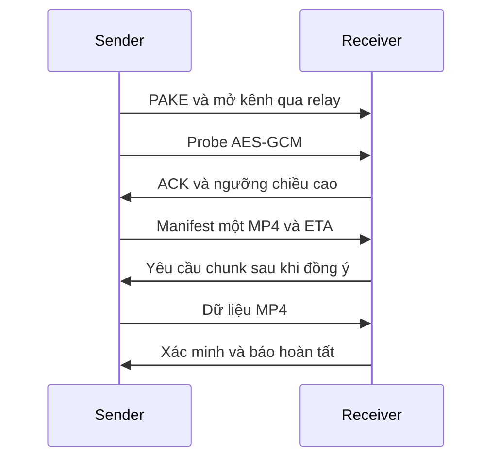

# Kiến trúc

Croc v11.6.6 dùng `src/cli/cli.go` để phân tích cờ và gọi `croc.NewCtx`, `Client.Send` hoặc `Client.Receive`. Lớp kết nối relay và luồng xác thực trong `src/croc/croc.go` thực hiện rendezvous, đổi PAKE, xác nhận khóa bằng `processMessagePakeConfirm` và kích hoạt data transport. Adaptive đặt transport sender ở chế độ relay và tắt khám phá LAN phía gửi. Relay chuyển tiếp frame Croc như bình thường.



## Điểm tích hợp

| Thành phần | Trách nhiệm |
| --- | --- |
| `src/adaptivevideo/input.go` | Đọc 2–16 đường dẫn, số byte và nhãn chiều cao. Từ chối tệp rỗng, thư mục, symlink tại đích đường dẫn, nguồn trùng và MP4 thiếu hộp `ftyp` hợp lệ. Kiểm tra file identity, mode, size và mtime trước/sau chuẩn bị tệp được chọn |
| `src/adaptivevideo/select.go` | Chọn theo chiều cao, kích thước thật, ngân sách và tốc độ đã dự phòng. Khi mọi bản đủ ngưỡng đều trễ, sắp theo byte tăng dần, ưu tiên chiều cao lớn hơn nếu bằng byte |
| `src/croc/tailcat_negotiation.go` | Thêm capability `adaptive-video-v1` vào thông điệp PAKE. Receiver mới quảng bá khả năng nhận. Sender chỉ quảng bá khi bật chế độ |
| `src/croc/adaptive_video.go` | Gửi và kiểm tra probe/ACK, áp dụng bộ chọn, xác thực manifest và chuyển lỗi điều khiển cho peer |
| `src/croc/file_manifest.go` | Gắn chiều cao, byte, ETA và tình trạng trễ vào header manifest. Chỉ bản đã chọn mới có file entry |
| `src/croc/croc.go`, `receive_preflight.go` | Hiện đề xuất cùng lời nhắc nhận, nhận đúng một MP4, kiểm tra full-file HighwayHash qua bước preflight của Croc trước khi hoàn tất |

Chiều cao và việc ba file mang cùng nội dung do sender khai báo. Kiểm tra hộp `ftyp` chỉ xác nhận cấu trúc đầu file và brand MP4 được phép. Script fixture gọi FFprobe kiểm tra video stream, chiều cao, thời lượng, bitrate và kích thước.

## Probe và deadline

`updateIfSenderChannelSecured` bắt đầu probe sau xác nhận khóa và trước `sendSenderInfo`. Control owner chỉ đọc một frame tại một thời điểm. Sender dùng đúng một mẫu 256 KiB từ `crypto/rand` để giảm tác động của nén. Mẫu và ID 16 byte ngẫu nhiên đi qua mã hóa AES-GCM sẵn có. ACK mang ID và ngưỡng nhận. Vai trò sai, ACK sai ID, ACK lặp, probe lặp và frame vượt giới hạn làm phiên thất bại. Giới hạn khi đợi probe là 512 KiB cho frame và JSON đã giải nén. ACK được giới hạn 4 KiB.

Sender đo đồng hồ monotonic trước thao tác ghi frame đến ACK hợp lệ, tối đa `min(8s, deadline)`. Receiver chờ probe tối đa 10 giây kể từ khi kênh sẵn sàng, bao gồm biên cho chuẩn bị và chênh lệch thời điểm hai đầu hoàn tất mở kênh. Ngân sách chọn bản trừ trực tiếp thời gian probe.

```text
raw_Bps    = 262144 / probe_elapsed_in_seconds
safe_Bps   = 0.8 * raw_Bps
eta        = file_size_bytes / safe_Bps
budget     = deadline - probe_elapsed
```

Ví dụ nếu `safe_Bps` là 312.500 B/s và còn 60 giây, các bản 75 MB, 12 MB và 4 MB có ETA 240, 38,4 và 12,8 giây. Với nhãn lần lượt 1080p, 360p và 144p, sender chọn 360p.

ETA mô tả truyền payload từ tốc độ quan sát trên kênh điều khiển. Giai đoạn chuẩn bị, hash, thao tác của người dùng, đóng file và xác minh có thời gian riêng. Số đo đầu cuối trong thực nghiệm vẫn tính cả khoảng từ sau probe đến lúc receiver hoàn thành.

## Từ chối, toàn vẹn và giới hạn

- Cả hai CLI cần hỗ trợ feature. Peer Croc gốc đúng tag nhận lỗi có mô tả trước payload khi gặp sender adaptive. Capabilities trong PAKE là tín hiệu khám phá. Phần quyết định dựa vào probe, ACK và manifest đã xác thực. Relay có thể trì hoãn hoặc làm rơi frame và làm phiên thất bại.
- Có ngưỡng nhưng không có bản phù hợp thì dừng. Có bản đủ ngưỡng song đều trễ thì lấy bản ước tính nhanh nhất trong số đó và buộc trả lời `y` hoặc `yes`. Cờ `--yes`, Enter và EOF không duyệt đề xuất trễ. Receiver khai báo ngưỡng sẽ yêu cầu sender dùng adaptive.
- Phiên adaptive dùng một tệp, transport relay, không nén lại MP4, kiểm tra file đầy đủ bằng HighwayHash và tắt tự reconnect cho cả hai đầu. Gián đoạn giữa lượt yêu cầu mở phiên mới. Tệp chưa hoàn tất có thể còn ở đích. Khi người dùng cho phép ghi đè ở phiên mới, bản dở bị thay và nhận lại từ đầu. Một bản hoàn chỉnh đã tồn tại có thể được Croc xác minh bằng hash thay cho tải lại.
- Bản đo TCP có một lane dữ liệu. Dùng nhiều lane, relay thật có RTT khác, tải CPU cao, lưu lượng cạnh tranh hoặc băng thông thay đổi có thể làm ETA sai lệch. Adaptive gửi file hoàn chỉnh và không có đổi chất lượng giữa phiên.
